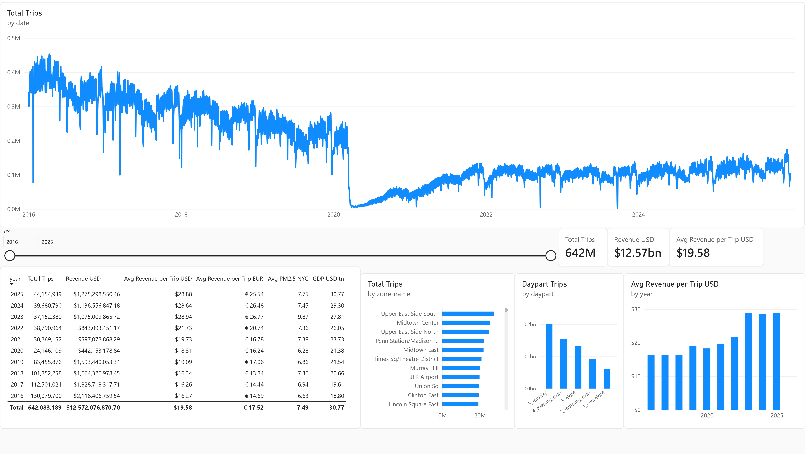
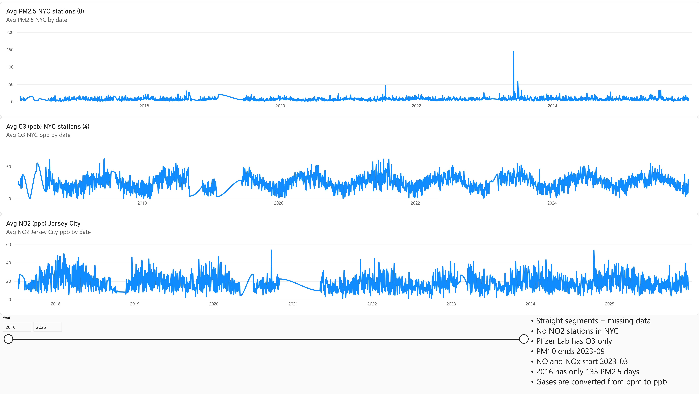
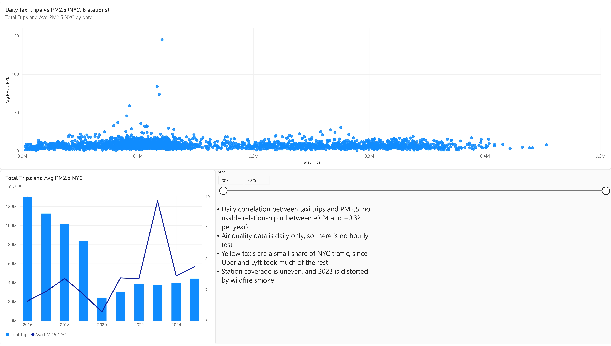
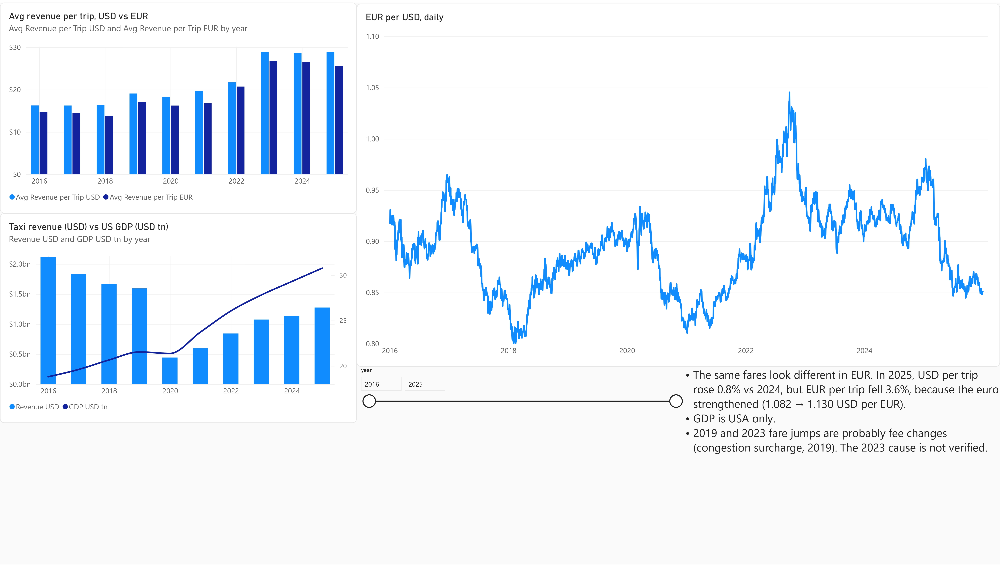

# NYC Mobility, Air Quality and Economy: Microsoft Fabric Project

A unified analytics platform built in Microsoft Fabric. It combines NYC yellow taxi trips (2016-2025), OpenAQ air quality measurements and macro-economic data (US GDP, USD/EUR exchange rate) in a medallion lakehouse (Bronze, Silver, Gold), a Warehouse star schema and a four-page Power BI report.

The main question: does taxi traffic explain air pollution in NYC, and how do mobility and the economy develop side by side over ten years?

## Architecture

Sources → Bronze (raw) → Silver (cleaned) → Gold (aggregated) → Warehouse (star schema) → semantic model → Power BI report

- **Ingestion:** a pipeline (`PL_Ingestion`) copies 120 monthly taxi Parquet files. A Dataflow Gen2 (`Dataflow_APIs`) loads OpenAQ daily measurements, ECB exchange rates and World Bank GDP.
- **Transformation:** PySpark in the notebook `NB_Transformations` (schema unification, validation rules, deduplication, daily aggregation, station-to-zone mapping).
- **Storage:** Lakehouse `LH_Taxi` holds Bronze, Silver and Gold tables. The Gold star schema is loaded into the Warehouse `Warehouse` with SQL.
- **Reporting:** semantic model `Mobility_Env_Economy` (Direct Lake, DAX measures, row-level security) and report `RPT_Mobility_Env_Economy`.

The full lineage diagram is in [docs/02_lineage_and_governance.md](docs/02_lineage_and_governance.md).

## Data sources

| Source | Content | Period |
|---|---|---|
| NYC TLC Yellow Taxi Trip Records | 642 million trips, monthly Parquet files | 2016-2025 |
| OpenAQ (API v3) | Daily pollutant averages from 14 stations around NYC | 2016-2025 |
| World Bank | US GDP in USD, yearly | 2016-2025 |
| ECB | Daily USD/EUR exchange rate | 2016-2025 |

## Key findings

- **No usable link between daily taxi trips and PM2.5.** The daily correlation per year stays between -0.24 and +0.32, and shows no consistent pattern at zone or time-of-day level either.
- **Yellow taxi trips fell by 66%** (130.1M in 2016 to 44.2M in 2025), while US GDP grew by 64%. Part of the fall is ride-hailing and part is COVID.
- **PM2.5 is flat over the period**, apart from 2023 (Canadian wildfire smoke in June). There is no sign of growth at the expense of air quality, and no sign of improvement.
- **Currency matters:** from 2024 to 2025 the average fare per trip rose 0.8% in USD but fell 3.6% in EUR, because the euro strengthened.
- **Time of day:** midday has the most trips in total, the evening rush is the busiest per hour.

## Report preview

Live report (read-only, public): [RPT_Mobility_Env_Economy](https://app.fabric.microsoft.com/view?r=eyJrIjoiMTQ2ODdjMWYtYTZiYi00ZmM1LThmYjItMTUzZGY0MjEzNjVhIiwidCI6IjYzOGQ1NWY5LTJmMGYtNDBlYS05NTRlLTgzNzU1MjVmZTMxYiJ9)

## Repository structure

- `docs/`: data dictionary, lineage and governance, final write-up, Warehouse load script (`warehouse_load.sql`)
- `fabric/`: item definitions exported through Fabric Git integration (notebook, pipeline, dataflow, lakehouse, warehouse, semantic model, report)
- `images/`: report screenshots

## Main limitations

- OpenAQ data is daily, so an hourly link between traffic and pollution could not be tested.
- Yellow taxis are only a small part of NYC traffic (Uber and Lyft are not included).
- None of the 9 stations inside NYC measures NO2. NO2 comes from one New Jersey station (Jersey City) and is shown as a regional proxy.
- Five of the 14 stations are in New Jersey, and are mapped to the nearest taxi zone only approximately. Station coverage differs between years.
- GDP is for the USA only.

The full list is in [docs/02_lineage_and_governance.md](docs/02_lineage_and_governance.md).

## Reproducibility

- The repository contains item definitions and documentation only. The data stays in OneLake and is not in this repo.
- The OpenAQ API key in the notebook is a placeholder (`YOUR_OPENAQ_API_KEY`). A personal key from openaq.org is needed to rerun the OpenAQ cells.
- The taxi ingestion pipeline is run manually when new months are published. Dataflow and semantic model refreshes are scheduled.
- The report lives in a Fabric trial workspace, so the screenshots above show its content.

## Documentation

1. [Data dictionary](docs/01_data_dictionary.md)
2. [Lineage and governance](docs/02_lineage_and_governance.md)
3. [Final write-up](docs/03_final_writeup.md)
