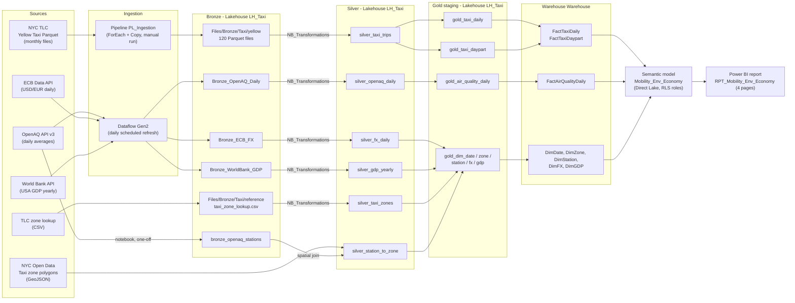

# Data Lineage and Governance Policies

**Project:** Microsoft Fabric – Mobility (NYC Taxi) + Air Quality (OpenAQ) + Economy (GDP & FX)
**Last updated:** 22 Nov 2026
**Related documents:** `01_data_dictionary.md` (table and column details)

> The diagrams use Mermaid. Most Markdown viewers (GitHub, GitLab, VS Code with an extension) render them. For Word or PDF, paste the code into https://mermaid.live and export a PNG or SVG. Every diagram also has a table version, which works anywhere.

---

# Part A – Lineage

## A.1 End-to-end lineage (overview)

**Reading the diagram:** data moves from left to right. Taxi files go through the pipeline. The three API sources go through the Dataflow (only the station coordinates were loaded once by a notebook). The Silver and Gold steps are PySpark in `NB_Transformations`. The Warehouse reads the Lakehouse by three-part name (`LH_Taxi.dbo.<table>`). The semantic model uses Direct Lake on the Warehouse tables.

> `bronze_openaq_stations` was written by a Spark notebook on 13 Nov 2026 at 18:50 (one `CREATE OR REPLACE TABLE AS SELECT`, notebook ID `0452ad1a-de76-435f-9c20-b33889731d6a`, the only notebook shown in the lineage view). Source: `DESCRIBE HISTORY bronze_openaq_stations`.

## A.2 Lineage table (table-level)

| # | Target | Source(s) | Transformation | Tool | Run mode |
|---|---|---|---|---|---|
| 1 | `Files/Bronze/Taxi/yellow/*.parquet` | NYC TLC monthly Parquet | Copy as Binary, no change | `PL_Ingestion` | Manual |
| 2 | `Bronze_OpenAQ_Daily` | OpenAQ API `/days` | JSON to table, add date, ids, parameter, value, units | Dataflow Gen2 | Daily schedule |
| 3 | `bronze_openaq_stations` | OpenAQ locations API | Select station id, name, coordinates, locality, country | Spark notebook (`NB_Transformations`) | Manual, one-off |
| 4 | `Bronze_ECB_FX` | ECB Data API (CSV) | Load as is | Dataflow Gen2 | Daily schedule |
| 5 | `Bronze_WorldBank_GDP` | World Bank API (JSON) | JSON to table | Dataflow Gen2 | Daily schedule |
| 6 | `Files/Bronze/Taxi/reference/taxi_zone_lookup.csv` | TLC zone lookup | Manual upload | Lakehouse upload | One time |
| 7 | `silver_taxi_trips` | Taxi Parquet files | Unify schema (23 columns: 20 TLC columns plus `pickup_year`, `pickup_month`, `source_file`), quality rules, deduplicate, partition by year and month | `NB_Transformations` | Manual, per month with `replaceWhere` |
| 8 | `silver_openaq_daily` | `Bronze_OpenAQ_Daily` | Remove negative values and duplicates, add year and month | `NB_Transformations` | Manual |
| 9 | `silver_fx_daily` | `Bronze_ECB_FX` | Fill weekends and holidays with last rate, add `eur_per_usd` and `is_filled` | `NB_Transformations` | Manual |
| 10 | `silver_gdp_yearly` | `Bronze_WorldBank_GDP` | Filter USA, 2016–2025 | `NB_Transformations` | Manual |
| 11 | `silver_taxi_zones` | `taxi_zone_lookup.csv` | CSV to Delta table | `NB_Transformations` | Manual |
| 12 | `silver_station_to_zone` | `bronze_openaq_stations` + NYC zone GeoJSON | Spatial join (inside, else nearest zone) | `NB_Transformations` (shapely) | Manual |
| 13 | `gold_taxi_daily` | `silver_taxi_trips` | Aggregate to date × pickup zone, store sums | `NB_Transformations` | Manual, per month |
| 14 | `gold_taxi_daypart` | `silver_taxi_trips` | Aggregate to date × zone × daypart | `NB_Transformations` | Manual |
| 15 | `gold_air_quality_daily` | `silver_openaq_daily` | Pivot parameters to columns, date × station | `NB_Transformations` | Manual |
| 16 | `gold_dim_date`, `gold_dim_zone`, `gold_dim_station`, `gold_dim_fx`, `gold_dim_gdp` | Silver tables, `silver_station_to_zone` | Build dimensions, add `in_nyc` and `zone_link_quality` | `NB_Transformations` | Manual |
| 17 | `Dim*`, `Fact*` in the Warehouse | `LH_Taxi.dbo.gold_*` | `CREATE TABLE` + `INSERT ... SELECT`, 2016–2025 only | Warehouse SQL | Manual |
| 18 | Semantic model `Mobility_Env_Economy` | Warehouse tables | Relationships, measures, RLS roles | Power BI web modeling | Direct Lake, auto-update on |
| 19 | Report `RPT_Mobility_Env_Economy` | Semantic model | Visuals on 4 pages | Power BI web report editor | Live |

## A.3 Column-level lineage for the key measures

| Report measure | Calculated from | Warehouse column(s) | Origin |
|---|---|---|---|
| `Total Trips` | `SUM` | `FactTaxiDaily[trips]` | TLC Parquet, after Silver cleaning |
| `Revenue USD` | `SUM` | `FactTaxiDaily[total_usd_sum]` | TLC `total_amount` (checked: 2016 sum in Silver 2,116,406,759.85 vs Gold 2,116,406,759.54, difference from floating-point rounding) |
| `Revenue EUR` | daily revenue × daily rate | `FactTaxiDaily[total_usd_sum]`, `DimFX[eur_per_usd]` | TLC + ECB |
| `Avg PM2.5 NYC` | `AVERAGE`, filter `in_nyc` | `FactAirQualityDaily[pm25_avg]`, `DimStation[in_nyc]` | OpenAQ + spatial join |
| `Avg O3 NYC ppb` | `AVERAGE` × 1000, filter `in_nyc` | `FactAirQualityDaily[o3_avg]` | OpenAQ (ppm to ppb) |
| `Avg NO2 Jersey City ppb` | `AVERAGE` × 1000, station filter | `FactAirQualityDaily[no2_avg]` | OpenAQ station 1122 |
| `GDP USD tn` | `TREATAS` on year | `DimGDP[gdp_usd]` | World Bank |

## A.4 Fabric lineage view

Reviewed on 24 Nov 2026 (workspace → **Lineage view**). The view shows two separate flows.

**Flow 1: ingestion**
- The ECB data API and the World Bank API (USA data) feed `Dataflow_APIs`, a Dataflow Gen2 (CI/CD) item.
- An HTTP server (the TLC CloudFront address) feeds the pipeline `PL_Ingestion`.
- `Dataflow_APIs` writes to `LH_Taxi`. `LH_Taxi` is connected to the notebook, to its SQL analytics endpoint and to `PL_Ingestion`.

**Flow 2: reporting**
- Warehouse → semantic model `Mobility_Env_Economy` → report. The semantic model shows a last refresh of 23 Nov 2026, 04:06.

**Differences from the table-level lineage in A.2** (limits of the view, not errors in the data):
1. OpenAQ is not shown as a source of `Dataflow_APIs`, although the dataflow loads `Bronze_OpenAQ_Daily` (A.2, row 2). Only the ECB and World Bank sources appear.
2. The two flows are not connected. The step from `LH_Taxi` to the Warehouse is not shown, probably because the Warehouse tables were loaded with SQL queries that read `LH_Taxi` by three-part name.
3. The view stops at item level. A.2 adds the table-level steps.

---

# Part B – Governance policies

## B.1 Purpose and scope

These policies describe how the data platform is owned, accessed, refreshed and controlled. They cover all items in the Fabric workspace: Lakehouse `LH_Taxi`, Warehouse `Warehouse`, Dataflow, Pipeline, Notebook, semantic model `Mobility_Env_Economy` and report `RPT_Mobility_Env_Economy`.

This is a learning project on open data. The policies are written as if the platform were used by a real team, so the framework can be reused.

## B.2 Data classification

| Dataset | Source licence and type | Sensitivity |
|---|---|---|
| NYC Yellow Taxi trips | Public open data (NYC TLC) | Public. Trip-level records contain no names. The Silver schema has no driver, passenger, licence or medallion fields and no coordinates, only vendor ID, zone IDs and payment type |
| OpenAQ air quality | Public open data | Public |
| ECB FX | Public reference rates | Public |
| World Bank GDP | Public statistics | Public |

**Policy B.2.1:** No personal or confidential data may be added to this platform without a new classification and a review of the access rules.

## B.3 Roles and ownership

| Role | Responsibility | Current holder |
|---|---|---|
| Data owner | Decides scope, sources and access | Project owner |
| Data engineer | Pipelines, Dataflow, notebook, Warehouse load | Project owner |
| Report author | Semantic model, measures, report | Project owner |
| Report consumer | Views report, subject to RLS | Viewers (none assigned in the trial workspace) |

**Policy B.3.1:** Only workspace Admin, Member and Contributor roles may change items. Consumers get the Viewer role or access to the report only.

## B.4 Access control and Row-Level Security

RLS roles are defined in the semantic model `Mobility_Env_Economy`:

| Role | Table | Filter | Purpose |
|---|---|---|---|
| `Borough_Manhattan` | `DimZone` | `[borough] = "Manhattan"` | Taxi data for Manhattan zones only |
| `NYC_Stations_Only` | `DimStation` | `[in_nyc] = TRUE()` | Air quality from the 9 NYC stations only, no New Jersey stations |

**Test evidence (22 Nov 2026, "Test as role" in the Power BI service)**

| Role | Check | Result |
|---|---|---|
| `Borough_Manhattan` | Total Trips on the report | 579,967,984 |
| `Borough_Manhattan` | SQL check on the Warehouse (`SUM(trips)` joined to `DimZone`, borough = Manhattan) | 579,967,984 (match, 90.3% of 642,083,189) |
| `NYC_Stations_Only` | Jersey City NO2 chart | Blank, as expected |
| `NYC_Stations_Only` | PM2.5 NYC | Unchanged |

**Design notes**
- The two roles filter different dimension tables. `DimStation` and `DimZone` have no relationship, so a zone role does not filter air quality. A user who needs both restrictions must be a member of both roles.
- RLS applies only to users with the Viewer role (or read access to the model). Workspace Admin, Member and Contributor roles bypass it.
- The first role test failed with an SSO error and worked after signing in again with fresh credentials.

**Policy B.4.1:** Every report audience that must be restricted gets a role. Members are assigned in the semantic model's Security menu, not by sharing the Warehouse directly.
**Policy B.4.2:** Each new role must be tested with "Test as role" and checked against a SQL query before release.

## B.5 Data quality rules

| Layer | Rule | Enforced where |
|---|---|---|
| Silver taxi | Drop-off after pick-up | `NB_Transformations` |
| Silver taxi | Distance between 0 and 100 miles | `NB_Transformations` |
| Silver taxi | Fare and total amount greater than 0 | `NB_Transformations` |
| Silver taxi | Zone IDs between 1 and 265 | `NB_Transformations` |
| Silver taxi | Duration under 6 hours | `NB_Transformations` |
| Silver taxi | Duplicates removed | `NB_Transformations` |
| Silver OpenAQ | Negative values and duplicates removed (14 rows) | `NB_Transformations` |
| Silver FX | No nulls. Gaps filled with the last known rate, flagged by `is_filled` | `NB_Transformations` |
| Gold | Yearly trip totals equal Silver (total 642,083,189) | Validation queries |
| Gold | No orphan keys: dates, zones and stations all exist in their dimensions | Validation queries |
| Warehouse | `SUM(trips)` equals Silver in both taxi fact tables | Validation queries |

**Policy B.5.1:** Silver data is never changed to hide a source anomaly. Anomalies are documented as caveats (see B.9) and excluded in the report through measures.

## B.6 Refresh and operations

| Component | Schedule | Mode | Notes |
|---|---|---|---|
| Dataflow Gen2 (OpenAQ, ECB FX, World Bank GDP) | Daily | Automatic | Refreshes Bronze only |
| Semantic model | "Keep your Direct Lake data up to date" is on | Automatic | Follows Warehouse table changes |
| Pipeline `PL_Ingestion` | Not scheduled | Manual | Reloads all 120 files (9.76 GB), so it runs only when a new month is published (about 2 months lag) |
| `NB_Transformations` (Silver, Gold) | Not scheduled | Manual | |
| Warehouse load (SQL) | Not scheduled | Manual | |

**Known limitation:** the automatic refresh stops at Bronze. New API data does not reach Silver, Gold, the Warehouse or the report until the notebook and the Warehouse load are run by hand.

**Recommended next step (not implemented):** one pipeline that chains Dataflow → Notebook → Warehouse load → semantic model refresh, then schedule it.

## B.7 Runbook: adding a new month of taxi data

1. Update the year-month list in `PL_Ingestion` and run it (or copy only the new file into `Files/Bronze/Taxi/yellow/`).
2. In `NB_Transformations`, rebuild `silver_taxi_trips` for that month with `replaceWhere`.
3. Rebuild `gold_taxi_daily` and `gold_taxi_daypart` for the same month.
4. Rebuild `gold_dim_date` and `gold_dim_fx` if the date range grows. The current range ends 2025-12-31.
5. Reload the Warehouse tables (run `DROP`, `CREATE`, `INSERT` as separate queries).
6. Run the validation queries (yearly trip totals, orphan keys).
7. Check the semantic model and the **Check** page of the report.

## B.8 Change management and naming

| Topic | Rule |
|---|---|
| Table names | `bronze_*`, `silver_*`, `gold_*` in the Lakehouse. `Dim*` and `Fact*` in the Warehouse |
| Measure names | Must not equal a column name (names are case-insensitive). Example: `Total Trips`, not `Trips` |
| Measure formatting | Set in the semantic model (Properties → Formatting) |
| Hidden items | `staginglakehousefordataflows` is system-managed. Do not delete |
| Dataflow outputs | Each query needs a Data destination pointing to `LH_Taxi` |
| Warehouse DDL | Run `DROP`, `CREATE`, `INSERT`, `ALTER` as separate queries |
| Keys | Primary keys in the Warehouse are NOT ENFORCED, so integrity is checked by validation queries |

## B.9 Known data limitations and risks

| # | Limitation | Handling |
|---|---|---|
| 1 | No NO2 measured at any of the 9 NYC stations | NO2 chart uses Jersey City only, labelled "NJ regional proxy, not NYC" |
| 2 | Pfizer Lab has no PM2.5 (O3 only) | Documented. It drops out of PM2.5 zone-level results |
| 3 | 5 stations are in New Jersey and snapped to the nearest NYC zone (approximate) | `in_nyc = 0`, excluded from NYC measures and RLS role `NYC_Stations_Only` |
| 4 | Bayonne NO2 sensor error (6–8 May 2022: 0.161 / 0.35 / 0.40 ppm) and other single-station NJ spikes | Not used in charts. Silver left unchanged |
| 5 | 2023-06-07 PM2.5 spike (170–200 µg/m³ at four NYC stations) | Confirmed as Canadian wildfire smoke. Kept as real data |
| 6 | PM10 ends 2023-09. NO and NOx start 2023-03 | Documented on the report |
| 7 | 2016 has only 133 PM2.5 days. Station count varies by year (6–8) | Documented. Year averages are not strictly like-for-like |
| 8 | Air quality data is daily, so no hourly test is possible | Documented |
| 9 | Yellow taxis are a small and shrinking share of NYC traffic (ride-hailing, COVID in 2020) | Interpretation caveat in the write-up |
| 10 | GDP is USA only | Documented |
| 11 | 1–3 Jan 2016 FX uses the last rate of 2015 (1.0887) | `is_filled = true` |
| 12 | 2026 air quality rows (4,305) are not in the Warehouse | Scope is 2016–2025 |
| 13 | Fare jumps in 2019 and 2023 are probably fee changes | **Not verified** (fee columns not analysed) |
| 14 | Dayparts have different lengths (6 h and 4 h) | Not comparable per hour |

## B.10 Monitoring

- **Lineage:** reviewed in the Fabric lineage view (see A.4).
- **Refresh status:** check the Dataflow and semantic model refresh history in the workspace.
- **Data checks:** after each load, run the validation queries listed in B.5.
- **Optional, not implemented:** Purview integration for catalog and classification, and refresh failure alerts.
